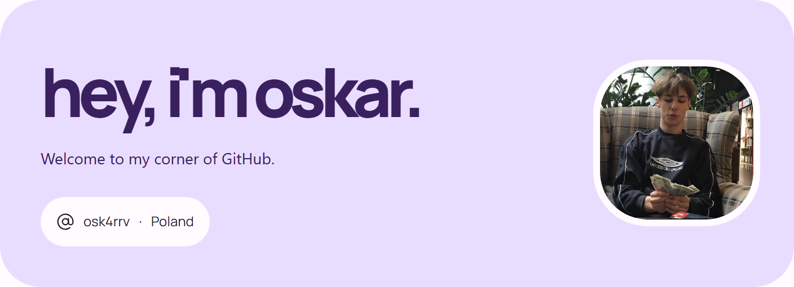
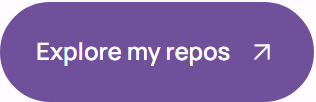
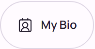
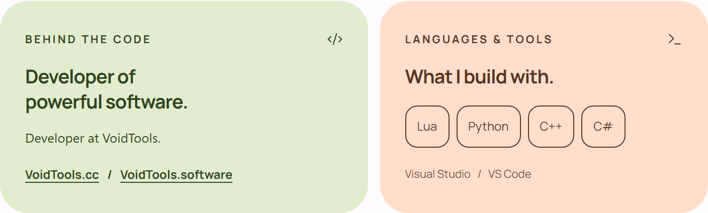
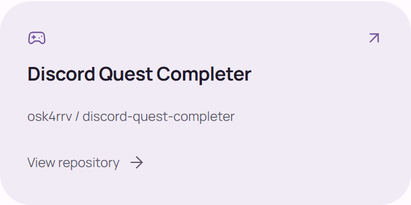
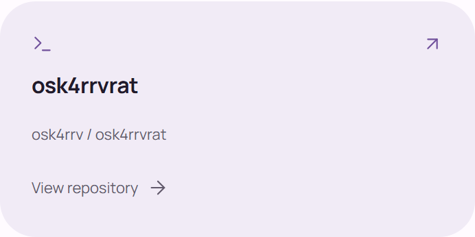

<!-- Material Design 3 inspired profile. Assets are stored in this repository. -->

<picture>
  <source media="(prefers-color-scheme: dark) and (max-width: 540px)" srcset="assets/hero-dark-mobile.png">
  <source media="(max-width: 540px)" srcset="assets/hero-light-mobile.png">
  <source media="(prefers-color-scheme: dark)" srcset="assets/hero-dark.png">
  
</picture>

<a href="https://github.com/osk4rrv?tab=repositories"><picture>
  <source media="(prefers-color-scheme: dark)" srcset="assets/explore-dark.png">
  
</picture></a>
&nbsp;
<a href="https://osk4rrv.github.io/biosite/"><picture>
  <source media="(prefers-color-scheme: dark)" srcset="assets/bio-dark.png">
  
</picture></a>

<picture>
  <source media="(prefers-color-scheme: dark) and (max-width: 540px)" srcset="assets/about-stack-dark-mobile.png">
  <source media="(max-width: 540px)" srcset="assets/about-stack-light-mobile.png">
  <source media="(prefers-color-scheme: dark)" srcset="assets/about-stack-dark.png">
  
</picture>

### Selected projects

<a href="https://github.com/osk4rrv/discord-quest-completer"><picture>
  <source media="(prefers-color-scheme: dark)" srcset="assets/quest-dark.png">
  
</picture></a>
<a href="https://github.com/osk4rrv/osk4rrvrat"><picture>
  <source media="(prefers-color-scheme: dark)" srcset="assets/rat-dark.png">
  
</picture></a>

---

osk4rrv

